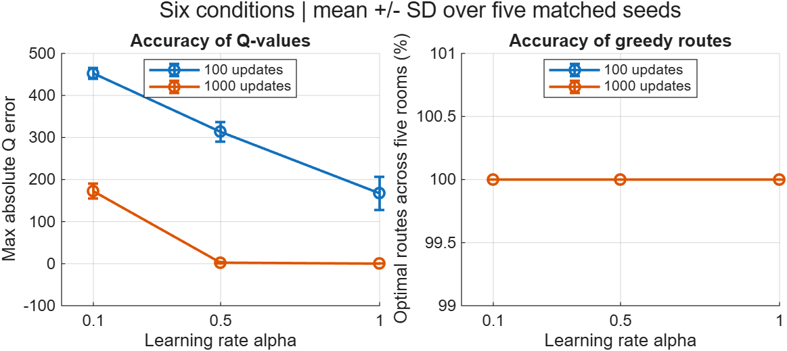

# Reinforcement Learning: Maze Example

A Q-learning implementation in MATLAB.

This repository presents a project from **Introduction to AI (인공지능개론)**,
taken at **Ewha Womans University in Spring 2026 (2026학년도 1학기)**,
taught by Prof. Hyunggon Park.

The project is based on the six-state Q-learning maze exercise in Chapter 18:
Reinforcement Learning. This repository documents its MATLAB implementation
and follow-up experiments comparing update budgets and learning rates.
The executable code is a single script: [`maze_qlearning.m`](maze_qlearning.m).

## Run one experiment

Upload `maze_qlearning.m` to MATLAB Online, open it, and change the settings
at the top of the file:

```matlab
nUpdates = 1000; % 100 or 1000
alpha = 0.5;     % 0.1, 0.5, or 1.0
```

Click **Run**. Each run starts from an all-zero Q-table, prints the learned
table, maximum Q error and greedy route, and displays a Q-table heatmap.
Only base MATLAB is required. The script runs one setting at a time and
does not automatically save files or overwrite the results included here.

Change one setting, then run again to compare. Keep `seed` fixed for a fair
comparison with the same sampled transitions. Change it when you want another
random trial. The default is seed 42. The report below averages five seeds;
a single run is not expected to equal that average.

## How the code works

1. Define the reward matrix `R` and initialize `Q`.
2. Randomly select a room and one legal destination.
3. Update `Q(s,a)` using the reward and best future Q-value.
4. Repeat for `nUpdates`, then follow the greedy route from `startRoom`.

Room 6 is EXIT. `R=-1` marks unavailable actions, which are excluded from
both sampling and maximization. In this lecture convention, moving to EXIT
from room 2 or 5 earns 100; staying at EXIT also earns 100. With gamma=0.8,
the optimal EXIT value is `100/(1-0.8)=500`. Training includes EXIT transitions;
route extraction stops on arrival at EXIT. One update is not a full episode.

The printed `maxQError` uses the lecture reference table and is evaluated only
when gamma=0.8. A small cycle check prevents an undertrained greedy policy from
looping forever. A displayed route is a learned greedy route, not a guarantee
of optimality for arbitrary settings.

## Completed experiment



The previously completed experiment used 100/1000 updates, alpha=0.1/0.5/1.0,
and five seeds per condition. All 30 runs found shortest routes from every
starting room, while Q-value accuracy varied substantially.

- [Full experiment report](docs/experiments.md)
- [Original MATLAB result table](results/experiments/results.md)
- [Summary CSV](results/experiments/summary.csv)
- [Raw runs CSV](results/experiments/raw_runs.csv)

**Version note:** the report and saved results are preserved unchanged from
the earlier multi-file implementation. Names such as `run_demo`,
`run_experiments`, and `test_maze` in those historical documents refer to that
version. The current code replaces those files with `maze_qlearning.m` for
manual experiments. It keeps the same lecture reward matrix, random sampling,
and Q-learning update, but does not generate the full comparison report.
The revised single-file script has not yet been executed in MATLAB.

## Attribution

The maze and reference Q-table come from the course exercise. This project
was prepared with AI assistance; the saved MATLAB measurements were produced
by the project owner. The original lecture slides are not redistributed.
