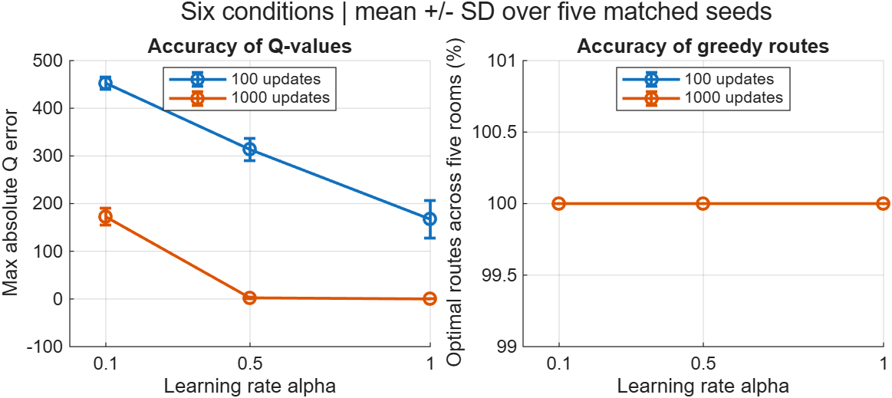
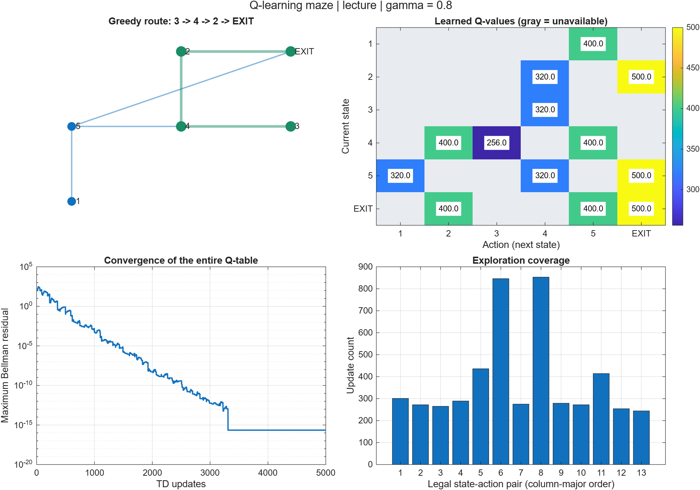

# Q-learning Maze: Effect of Update Budget and Learning Rate

Sujung Yun · Course-based MATLAB experiment · 6 November 2026

## Abstract

This experiment compares two update budgets (100 and 1000) and three learning
rates (0.1, 0.5, and 1.0) in a six-state deterministic maze. Each condition uses
five matched random seeds. More updates and larger learning rates reduced the
mean maximum Q-value error within the tested settings. All 30 runs nevertheless
produced shortest routes from all five starting rooms. Accurate action ordering
was therefore sufficient for the evaluated routes before Q-values fully converged.

## 1. Environment and method

The maze is based on the Introduction to AI Chapter 18 exercise by Prof. Hyunggon
Park at Ewha Womans University. States 1–5 are rooms and state 6 is EXIT. An
action selects a legal destination state. The experiment uses the `lecture`
continuing-task convention: entering EXIT from room 2 or 5 gives 100, remaining
at EXIT gives 100, and other legal moves give zero. Discount gamma is 0.8.
The continuing convention is reconstructed from the printed reference Q-table;
it is distinct from the handwritten terminal-exit interpretation.

The optimal EXIT self-loop value is 100/(1−0.8) = 500. Greedy route evaluation
stops at the first arrival at EXIT even though training includes transitions
from EXIT. Illegal actions are masked during sampling and maximization.

Each run starts with Q=0 and performs the update

`Q(s,a) ← Q(s,a) + alpha [R(s,a) + gamma max Q(nextState,legalActions) − Q(s,a)]`.

One update samples an active state uniformly and then one of its legal actions
uniformly. These are random-reset TD updates, not full episodes. State-action
pairs are not globally uniform: states with fewer legal actions allocate more
samples to each action. This explains the unequal visit bars in the demo.

| Setting | Values |
|---|---|
| TD updates | 100, 1000 |
| Learning rate alpha | 0.1, 0.5, 1.0 |
| Random seeds | 1, 7, 21, 42, 99 |
| Discount factor | 0.8 |
| Conditions and runs | 6 conditions, 5 seeds each, 30 runs |
| Execution environment | MATLAB Online; exported version: R2026b Update 1 |

The seed is reset for every run. For a given seed, learning rates share the
same sampled transition sequence; the 100-update sequence is the prefix of the
1000-update sequence. The environment and initialization remain fixed.

## 2. Evaluation

- **Maximum Q error:** maximum absolute difference between the learned and
  analytical optimal Q-values over legal pairs. Each run is reduced to one
  maximum error; those five maxima are then averaged within a condition.
- **Optimal-route percentage:** percentage of the five starting rooms whose
  greedy path reaches EXIT in the minimum number of moves, checked against
  unweighted graph distances. Cycles count as failures. Ties within 1e-8 select
  the smallest destination index.
- **Bellman residual:** maximum absolute Bellman optimality inconsistency over
  legal pairs, used as an additional convergence diagnostic.

The table and error bars use sample standard deviation across five seeds,
not standard error or a confidence interval.

## 3. Measured results

| Updates | Alpha | Maximum Q error (mean ± SD) | Optimal routes (%) | Bellman residual (mean ± SD) |
|---:|---:|---:|---:|---:|
| 100 | 0.1 | 452.565 ± 12.592 | 100 ± 0 | 92.349 ± 1.70544 |
| 100 | 0.5 | 313.424 ± 24.0775 | 100 ± 0 | 92.3662 ± 24.7322 |
| 100 | 1.0 | 167.251 ± 39.8486 | 100 ± 0 | 54.6151 ± 33.6071 |
| 1000 | 0.1 | 172.221 ± 17.6337 | 100 ± 0 | 38.265 ± 3.28666 |
| 1000 | 0.5 | 2.22299 ± 1.6754 | 100 ± 0 | 0.750402 ± 0.768439 |
| 1000 | 1.0 | 0.00981379 ± 0.0164556 | 100 ± 0 | 0.006128 ± 0.0113286 |

The original exported numeric records are preserved in
[summary.csv](../results/experiments/summary.csv) and
[raw_runs.csv](../results/experiments/raw_runs.csv). The
[MATLAB-generated results page](../results/experiments/results.md) records the
MATLAB version and runtime timestamp. Its timestamp is retained as exported;
its time zone is not specified.

### Effect of update budget

Increasing the budget from 100 to 1000 reduced mean maximum Q error for every
tested alpha: 452.565 → 172.221 at alpha=0.1, 313.424 → 2.22299 at alpha=0.5,
and 167.251 → 0.00981379 at alpha=1.0. However, 1000 updates with alpha=0.1
still had slightly more mean error than 100 updates with alpha=1.0. Budget
alone does not describe the amount of learning achieved.

### Effect of learning rate

At each fixed budget, larger alpha reduced mean maximum Q error in these data.
Alpha=1.0 at 1000 updates gave the lowest mean error among the six conditions.
Its error was small but nonzero: 0.00981379 ± 0.0164556. The original linear-scale
plot visually compresses this value and the alpha=0.5 value near zero.
The Bellman residual is a different metric: at 100 updates, its mean is almost
the same for alpha=0.1 and 0.5 despite the clear difference in Q error.

### Policy quality before value convergence

Every raw run reports 100% optimal routes and 100% exit arrival across the five
starting rooms. Thus all 150 start-room evaluations succeeded, although these
are structured evaluations across matched seeds rather than independent random
trials. In particular, alpha=0.1 with 100 updates had mean maximum Q error
452.565 while still selecting optimal routes.

The greedy policy depends on the ordering of available Q-values, not their
absolute accuracy. These data demonstrate that correct route selection can
precede convergence of the Q-table. The route-score plot has a ceiling effect:
both budget curves overlap at 100%, and this metric cannot rank the six
conditions on this small maze.

## 4. Demo consistency check

The separately supplied 5000-update demo figure shows the route
`3 → 4 → 2 → EXIT`. Its exported Q-table matches the analytical table at the
CSV's stored precision. All five exported routes have shortest lengths
2, 1, 3, 2, and 1. These data are in
[lecture_qtable.csv](../results/lecture_qtable.csv) and
[lecture_routes.csv](../results/lecture_routes.csv).

The demo plots `max(residual,eps)` on a logarithmic axis, so the final plateau
is a plotting floor. It should not be interpreted as a measured positive
residual of exactly eps. The demo uses a larger budget than the comparison
experiment and is not a seventh experimental condition.

## 5. Reproducibility and checks

Run `run_demo`, then `run_experiments` from the repository folder in MATLAB
Online. Only base MATLAB is required. Repeating an experiment overwrites its
generated files, so preserve the current outputs before changing parameters.

The supplied raw data contain exactly 30 unique budget/alpha/seed combinations.
Means and sample standard deviations were independently recomputed and agree
with summary.csv within numerical tolerance. The original exported images and
data were retained without redrawing or changing measurements.

The separate `test_maze` test suite is included, but its execution outcome was
not supplied and is not claimed here. The reported MATLAB evidence covers the
lecture-mode demo and comparison, not a runtime verification of episodic mode.

## 6. Limitations and conclusion

This experiment uses a small deterministic maze, two update budgets and five
seeds. It does not establish a generally optimal learning rate, statistical
significance, performance on stochastic environments, or the minimum update
count required for an optimal policy. The observed results are consistent with
fast direct updates in a deterministic task. Alpha=1.0 should not automatically
be preferred for noisy rewards or transitions.

Within these six conditions, more updates and larger alpha improved Q-value
accuracy, while every evaluated greedy policy already found shortest routes.
Value error and route quality should therefore be reported together.

## Attribution

Course topology and reference Q-table: Prof. Hyunggon Park, Introduction to AI,
Chapter 18, Ewha Womans University. Implementation and report preparation used
AI assistance; the MATLAB runs and exported measurements were supplied by the
project owner. The original lecture slides are not redistributed.
