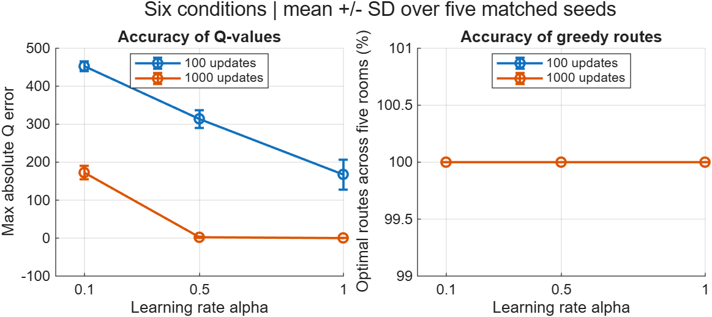

# MATLAB experiment results

Generated by `run_experiments.m`. MATLAB 26.2.0.3433840 (R2026b) Update 1, 2026-11-06 12:53:54.

Lecture mode, gamma = 0.8. Five matched seeds per condition.
Values below are mean +/- sample standard deviation.

| Updates | Alpha | Max Q error | Optimal routes (%) | Bellman residual |
|---:|---:|---:|---:|---:|
| 100 | 0.1 | 452.6 +/- 12.59 | 100.0 +/- 0.0 | 92.35 +/- 1.705 |
| 100 | 0.5 | 313.4 +/- 24.08 | 100.0 +/- 0.0 | 92.37 +/- 24.73 |
| 100 | 1.0 | 167.3 +/- 39.85 | 100.0 +/- 0.0 | 54.62 +/- 33.61 |
| 1000 | 0.1 | 172.2 +/- 17.63 | 100.0 +/- 0.0 | 38.26 +/- 3.287 |
| 1000 | 0.5 | 2.223 +/- 1.675 | 100.0 +/- 0.0 | 0.7504 +/- 0.7684 |
| 1000 | 1.0 | 0.009814 +/- 0.01646 | 100.0 +/- 0.0 | 0.006128 +/- 0.01133 |

See raw_runs.csv for individual runs and ../../docs/experiments.md for the protocol.
